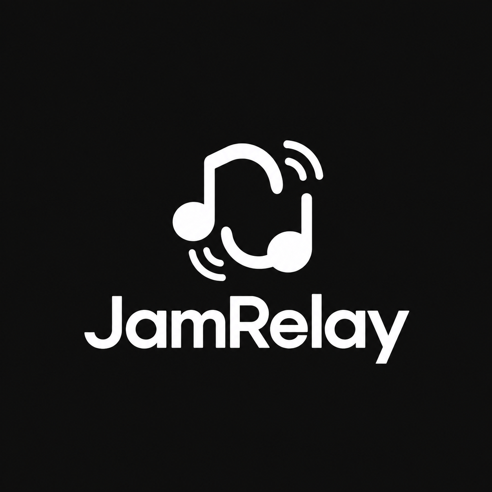

<div align="center">

<picture>
  <source media="(prefers-color-scheme: dark)" srcset="assets/logos/jamrelay-logo-dark.png.png">
  <source media="(prefers-color-scheme: light)" srcset="assets/logos/jamrelay-logo-light.png.png">
  
</picture>

**Self-hosted music automation for AI agents through MCP.**

[](https://github.com/makkiattooo/JamRelay/releases)
[](LICENSE)
[](https://github.com/makkiattooo/JamRelay/actions/workflows/ci.yml)
[](package.json)
[](docs/mcp-client.md)
[](docs/providers/)
[](https://m8ven.ai/mcp/makkiattooo-jamrelay-1qzbwr?s=readme)

[Documentation](https://makkiattooo.github.io/JamRelay/) · [Quick start](docs/installation.md) · [Polski](docs/pl/index.md)

</div>

## What is JamRelay?

JamRelay connects compatible AI assistants to your music services. Search for
music, organize playlists and run repeatable music workflows through one MCP
server that you host and control.

It supports Spotify, SoundCloud, Apple Music and YouTube. Each provider keeps
its own connection and capabilities; an installation can start without any
connected accounts.

## Key features

- **Music workflows:** search, playlist organization, transfers and automation.
- **Preview before writing:** dry runs, snapshots and recovery information for
  supported playlist operations.
- **Durable jobs:** long-running work with progress, cancellation and recovery.
- **Owner-controlled access:** explicit provider authorization and MCP grants.
- **Local operation:** persistent state, encrypted provider credentials and an
  operator CLI, with no web administration dashboard.

See the [guides](docs/playlist-automation.md) and
[provider capabilities](docs/providers/capabilities.md) for supported operations
and their limits.

## Quick start

Requires **Node.js 22.13 or later**. Once the official npm package is published:

```bash
npm install -g jamrelay
jamrelay setup
jamrelay start
```

The terminal wizard configures storage, owner security and optional providers.
You obtain provider developer credentials yourself and authorize accounts
separately through the owner consent flow.

**Public distribution is pending.** For a development checkout or candidate
archive, follow [installation](docs/installation.md). The same page covers the
recommended Docker Compose workflow and persistent storage.

## Supported providers

| Provider    | Integration                                                 |
| ----------- | ----------------------------------------------------------- |
| Spotify     | Catalog, playlists, library and supported playback controls |
| SoundCloud  | Catalog and playlists                                       |
| Apple Music | Catalog and supported MusicKit library playlist operations  |
| YouTube     | Videos and playlists through YouTube Data API v3            |

Features differ by provider. See [provider setup](docs/providers/index.md) for
credentials, authorization and capability restrictions. Spotify playback
requires an eligible account and active device.

## Connect your AI agent

Add the MCP endpoint shown by setup to a compatible client, complete owner
OAuth consent, then request its tool list to verify the connection. The local
default is `http://localhost:5267/mcp`; remote access requires reachable HTTPS.

[ChatGPT](docs/clients/chatgpt.md) · [Claude](docs/clients/claude.md) ·
[Cursor](docs/clients/cursor.md) · [Other MCP clients](docs/clients/index.md)

## Documentation

- [Install and deploy](docs/installation.md)
- [Connect music providers](docs/provider-connections.md)
- [Connect an AI client](docs/clients/index.md)
- [CLI updates, notices and offline information](docs/cli-information.md)
- [Operations and backups](docs/operations.md)
- [Generated MCP tool reference](docs/tools-reference.md)
- [Security](docs/security.md)

English is canonical. Entry points are available in [Polski](docs/pl/index.md),
[Deutsch](docs/de/index.md), [Français](docs/fr/index.md) and
[Español](docs/es/index.md); incomplete translations link to English references.

For release history, see [CHANGELOG](CHANGELOG.md) and
[GitHub Releases](https://github.com/makkiattooo/JamRelay/releases).

## Contributing & license

Read [CONTRIBUTING](CONTRIBUTING.md) before submitting changes and
[SECURITY](SECURITY.md) to report a vulnerability.

JamRelay is licensed under [AGPL-3.0-only](LICENSE); see
[licensing](LICENSING.md) for additional information.

This is an unofficial community project, unaffiliated with music providers or
AI platform vendors. Provider terms and API limitations still apply.
